  

  
  
  

## About

I'm a product designer in Bengaluru who also writes code. I design in Figma, then build in HTML, CSS and JavaScript, so a handoff turns into a conversation instead of a gap. My own [portfolio](https://yuvrajsoni.in) is hand-coded from scratch.

I'm not a full-time developer, and I don't pretend to be. I code to prototype faster, to make design intent unambiguous, and to ship small things on my own.

**Right now:** Associate Product Designer at **AppsForBharat**, working on **Sri Panchangam**, a daily panchang app for Telugu speaking users, many of them first-time smartphone users. The hard part is simplifying a dense, culturally loaded format without losing what makes it feel right. I spend as much time in analytics and session recordings as I do in Figma.

## Toolbox

## Experience

---

  Open to product design roles, on-site, hybrid or remote. 
  If you're building in fintech, healthtech or AI-driven products, <a href="https://www.linkedin.com/in/yuvrajsoni/">say hi</a>.

